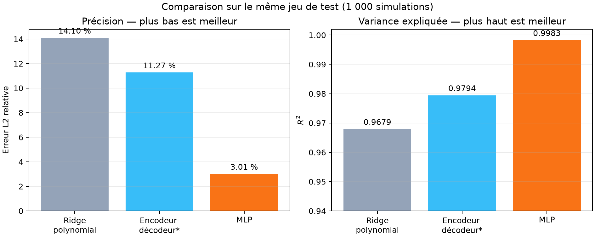
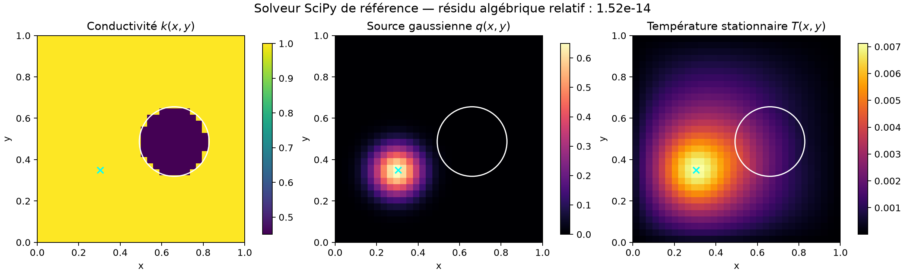
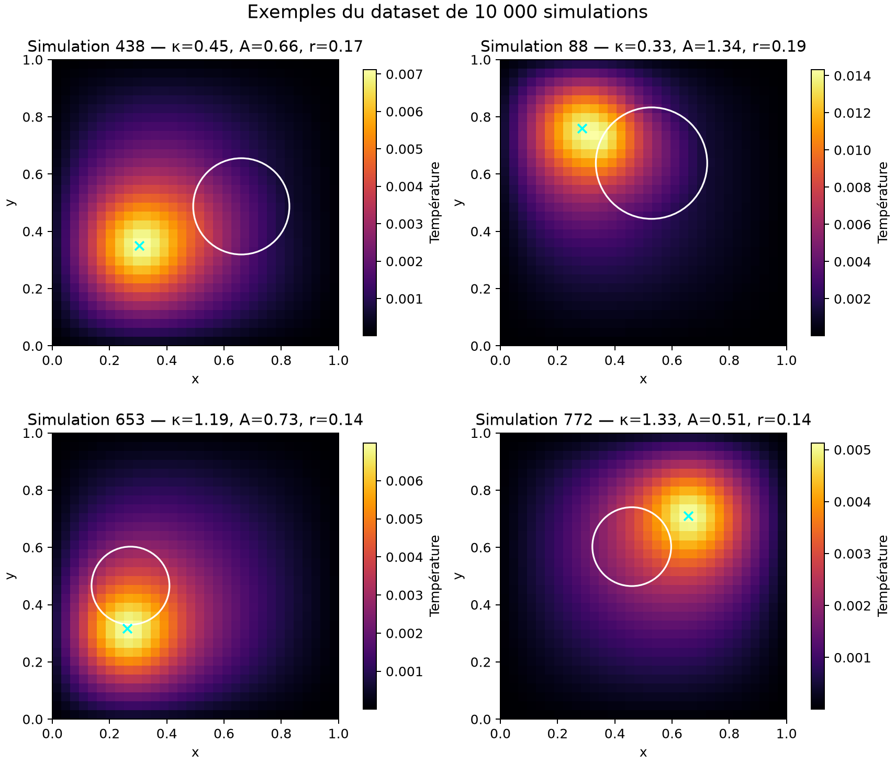
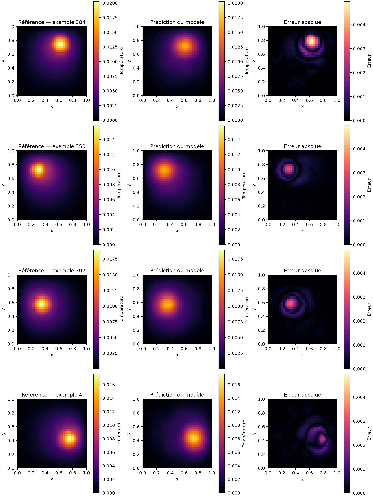
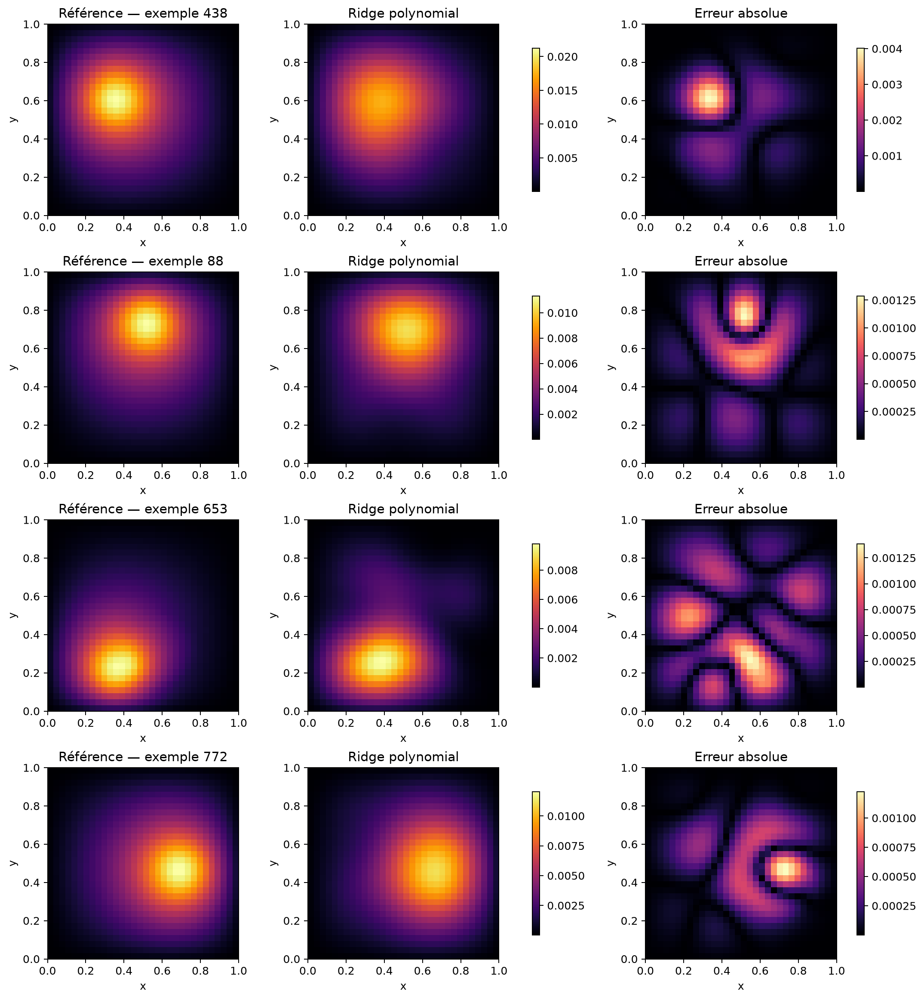
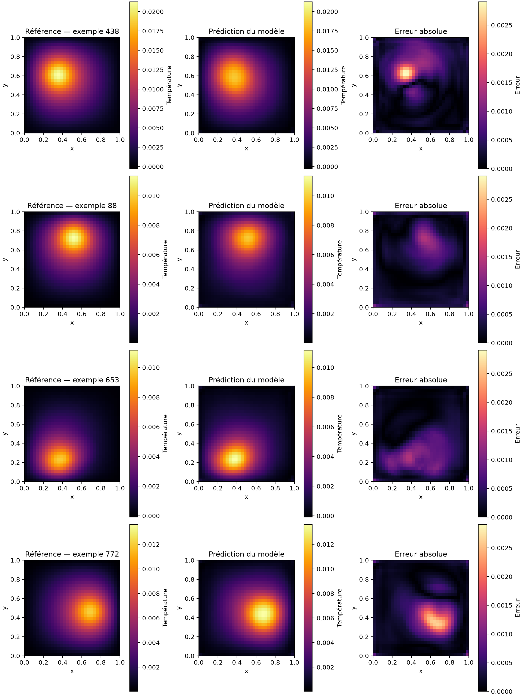
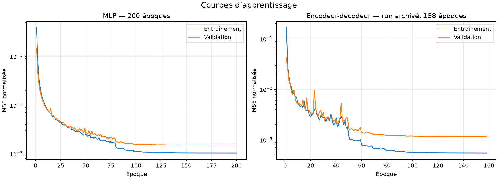

# Scientific ML Surrogate Model

Modèle de substitution pour accélérer la résolution d’un problème paramétré de conduction thermique stationnaire dans une plaque 2D hétérogène.

Le projet combine un **solveur numérique conservatif SciPy**, la génération d’un dataset de simulations et plusieurs modèles de machine learning capables de prédire un champ de température complet à partir de seulement sept paramètres physiques.

> **Meilleur résultat actuel — MLP** : erreur $L^2$ relative moyenne de **3,01 %**, $R^2=0,9983$ et accélération mesurée d’environ **×1 912** en inférence GPU par lot par rapport au solveur SciPy.



## Objectif scientifique

Le domaine est le carré unité $\Omega=(0,1)^2$. La température stationnaire vérifie :

$$
-\nabla\cdot\left(k(x,y;\theta)\nabla T(x,y)\right)=q(x,y;\theta),
\qquad T\vert_{\partial\Omega}=0.
$$

Le matériau contient une inclusion circulaire de conductivité $\kappa$, tandis que la chaleur est produite par une source gaussienne localisée. Le vecteur d’entrée est :

$$
\theta=(\log\kappa,c_x,c_y,r,A,s_x,s_y).
$$

| Paramètre | Intervalle | Description |
|---|---:|---|
| $\kappa$ | $[0,25;4,0]$ | Rapport de conductivité inclusion/fond |
| $c_x,c_y$ | $[0,25;0,75]$ | Centre de l’inclusion |
| $r$ | $[0,10;0,20]$ | Rayon de l’inclusion |
| $A$ | $[0,5;2,0]$ | Amplitude de la source |
| $s_x,s_y$ | $[0,20;0,80]$ | Centre de la source |

La formulation complète est détaillée dans [docs/problem_definition.md](docs/problem_definition.md).

## Solveur physique de référence

Le solveur assemble un système creux de $32\times32=1\,024$ inconnues avec :

- une discrétisation conservative en différences finies ;
- une moyenne harmonique de la conductivité aux interfaces ;
- des conditions de Dirichlet homogènes ;
- une résolution creuse en double précision avec `scipy.sparse.linalg.spsolve`.



Sur l’exemple affiché, le résidu algébrique relatif du solveur est de l’ordre de $10^{-14}$.

## Pipeline expérimental

```text
7 paramètres physiques
          │
          ▼
 Solveur SciPy creux ─────► 10 000 champs de référence 32 × 32
                                      │
                    ┌─────────────────┼─────────────────┐
                    ▼                 ▼                 ▼
          Ridge polynomial   Encodeur-décodeur         MLP
                    │                 │                 │
                    └─────────────────┼─────────────────┘
                                      ▼
                         Prédiction de 1 024 températures
```

Le dataset contient **10 000 simulations** en `float32` :

- 8 000 simulations d’entraînement ;
- 1 000 simulations de validation ;
- 1 000 simulations de test ;
- split reproductible avec la graine 42 ;
- température observée dans le dataset : $[2,58\times10^{-6};4,58\times10^{-2}]$.



Le cercle blanc représente l’inclusion et la croix cyan le centre de la source thermique.

## Modèles comparés

| Modèle | Bibliothèque | Architecture | Entraînement du run comparé |
|---|---|---|---:|
| Ridge polynomial | scikit-learn | Polynômes degré 3 + Ridge, $\alpha=10^{-6}$ sélectionné sur validation | ajustement fermé |
| Encodeur-décodeur | TensorFlow/Keras | Dense vers tenseur $4\times4\times64$, puis sur-échantillonnages et convolutions | 2 époques* |
| MLP | TensorFlow/Keras | 7 → 128 → 256 → 512 → 1 024 | 200 époques |

L’encodeur-décodeur contient **201 089 paramètres** et le MLP **690 944 paramètres**.

\* Le run encodeur-décodeur retenu dans le tableau est un essai versionné de seulement deux époques. Il constitue un point de comparaison préliminaire, pas encore une comparaison à budget d’entraînement égal.

## Résultats sur le jeu de test

Les trois modèles sont évalués sur les mêmes **1 000 simulations jamais utilisées pour l’entraînement**.

| Modèle | MAE ↓ | RMSE ↓ | $L^2$ relatif ↓ | Erreur sur $T_{max}$ ↓ | Erreur absolue max. ↓ | $R^2$ ↑ |
|---|---:|---:|---:|---:|---:|---:|
| Ridge polynomial | $3,252\times10^{-4}$ | $5,301\times10^{-4}$ | **14,10 %** | $1,713\times10^{-3}$ | $1,891\times10^{-2}$ | 0,9679 |
| Encodeur-décodeur | $2,896\times10^{-4}$ | $4,316\times10^{-4}$ | **11,27 %** | $1,043\times10^{-3}$ | $1,369\times10^{-2}$ | 0,9794 |
| **MLP** | **$7,812\times10^{-5}$** | **$1,187\times10^{-4}$** | **3,01 %** | **$2,450\times10^{-4}$** | **$5,065\times10^{-3}$** | **0,9983** |

Le MLP est actuellement le meilleur modèle sur toutes les métriques globales. Il réduit l’erreur $L^2$ d’un facteur d’environ **4,7** par rapport au baseline scikit-learn.

### Distribution de l’erreur du MLP

| Statistique | Erreur $L^2$ relative |
|---|---:|
| Médiane | 2,68 % |
| 90e percentile | 4,72 % |
| 99e percentile | 7,97 % |
| Pire cas | 15,95 % |



Même sur les quatre pires simulations, le modèle retrouve la position de la source et la structure globale du champ. L’erreur principale est une légère sous-estimation ou un lissage des pics thermiques.

<details>
<summary>Afficher les prédictions des autres baselines</summary>

### Ridge polynomial



### Encodeur-décodeur



</details>

## Courbes d’apprentissage



Les courbes montrent une convergence stable. L’écart entre entraînement et validation reste limité, mais le plateau de validation suggère que les prochaines améliorations viendront davantage de la fonction de coût, du sampling et de l’architecture que d’un simple allongement de l’entraînement.

La courbe encodeur-décodeur affichée provient du run historique de 158 époques ; elle sert au diagnostic d’apprentissage et ne correspond pas au run court de deux époques utilisé dans le tableau comparatif.

## Accélération mesurée

Pour le MLP, l’évaluation directe d’un lot de 1 000 cas donne :

| Mesure | Valeur |
|---|---:|
| Temps moyen du solveur SciPy | 11,45 ms / simulation |
| Temps ML amorti sur un lot GPU | 5,99 µs / simulation |
| Débit ML | 167 046 simulations / seconde |
| Accélération mesurée | **×1 912** |

Cette accélération mesure le **débit en inférence GPU par lot** après préchauffage. Elle ne doit pas être interprétée comme la latence d’une requête isolée et dépend du matériel ainsi que de la taille du batch.

## Cohérence physique

Le projet évalue aussi le résidu discret :

$$
r_{PDE}=\frac{\lVert K\widehat T-q\rVert_2}{\lVert q\rVert_2}.
$$

| Champ évalué | Résidu moyen | Médiane | 90e percentile | Maximum |
|---|---:|---:|---:|---:|
| Références SciPy | $3,07\times10^{-6}$ | — | — | $8,48\times10^{-6}$ |
| Prédictions MLP | 0,934 | 0,814 | 1,523 | 3,249 |

Le modèle est donc **très précis sur le champ de température**, mais il ne satisfait pas encore strictement l’équation locale. Les dérivées secondes amplifient les petites irrégularités visibles dans les cartes d’erreur. Ce résultat motive la prochaine étape : une loss hybride données + physique,

$$
\mathcal L=\mathcal L_{data}+\lambda_{phys}\mathcal L_{PDE}.
$$

Cette limite est volontairement documentée : le modèle actuel est un excellent surrogate supervisé, mais pas encore un modèle physiquement contraint.

## Reproduire l’expérience

### Installation

Le projet utilise Python 3.13 et [`uv`](https://docs.astral.sh/uv/) :

```bash
git clone https://github.com/FlorianBarbe/Scientific-ML-Surrogate-Model.git
cd Scientific-ML-Surrogate-Model
uv sync
source .venv/bin/activate
```

Une installation classique reste possible :

```bash
python -m venv .venv
source .venv/bin/activate
python -m pip install --upgrade pip
pip install -e .
```

### Générer les données

```bash
python scripts/generate_dataset.py --samples 10000 --seed 42
python scripts/visualize_dataset.py
```

Ajoutez `--overwrite` uniquement pour remplacer volontairement un dataset existant.

### Entraîner les modèles

```bash
# Baseline scikit-learn
python scripts/train_baselines.py --degree 3 --seed 42

# Encodeur-décodeur convolutionnel
python scripts/train_keras.py --model encoder_decoder --epochs 200 --batch-size 64

# MLP actuellement le plus performant
python scripts/train_keras.py --model mlp_baseline --epochs 200 --batch-size 128
```

Chaque entraînement crée un dossier unique dans `artifacts/runs/<date>_<modèle>/` afin de ne jamais écraser un modèle précédent.

### Évaluer un run Keras

```bash
python scripts/evaluate.py --run artifacts/runs/<identifiant_du_run>
```

L’évaluation sauvegarde les métriques, les prédictions et les cartes d’erreur dans le sous-dossier `evaluation/` du run.

### Tests

```bash
pytest
```

## Organisation du projet

```text
Scientific-ML-Surrogate-Model/
├── data/generated/                   # datasets locaux, non versionnés
├── artifacts/runs/                   # modèles et métriques, non versionnés
├── docs/
│   ├── assets/                       # figures légères intégrées au README
│   └── problem_definition.md         # formulation mathématique complète
├── scripts/
│   ├── generate_dataset.py
│   ├── generate_readme_assets.py
│   ├── train_baselines.py
│   ├── train_keras.py
│   ├── evaluate.py
│   └── visualize_dataset.py
├── src/scientific_ml_surrogate_model/
│   ├── dataset.py
│   ├── metrics.py
│   ├── models.py
│   ├── physics_stationary.py
│   ├── physics_transient.py
│   └── physics_transient_extended.py
└── tests/
```

## Prochaines étapes

- intégrer le résidu PDE dans la fonction de coût ;
- entraîner l’encodeur-décodeur à budget égal au MLP ;
- ajouter des tests de convergence en maillage ;
- mesurer séparément latence unitaire et débit par lot ;
- étendre le surrogate au problème thermique transitoire ;
- tester des opérateurs neuronaux ou une représentation latente du champ.

## English summary

This repository implements a machine-learning surrogate for parameterized steady-state heat conduction in a heterogeneous 2D plate. A conservative SciPy solver generates 10,000 reference simulations on a $32\times32$ grid. The current best MLP reaches a **3.01% mean relative $L^2$ error**, **$R^2=0.9983$**, and an approximately **1,912× measured batched-GPU throughput speedup** over the sparse numerical solver. The discrete PDE residual remains a documented limitation and motivates physics-informed training.
